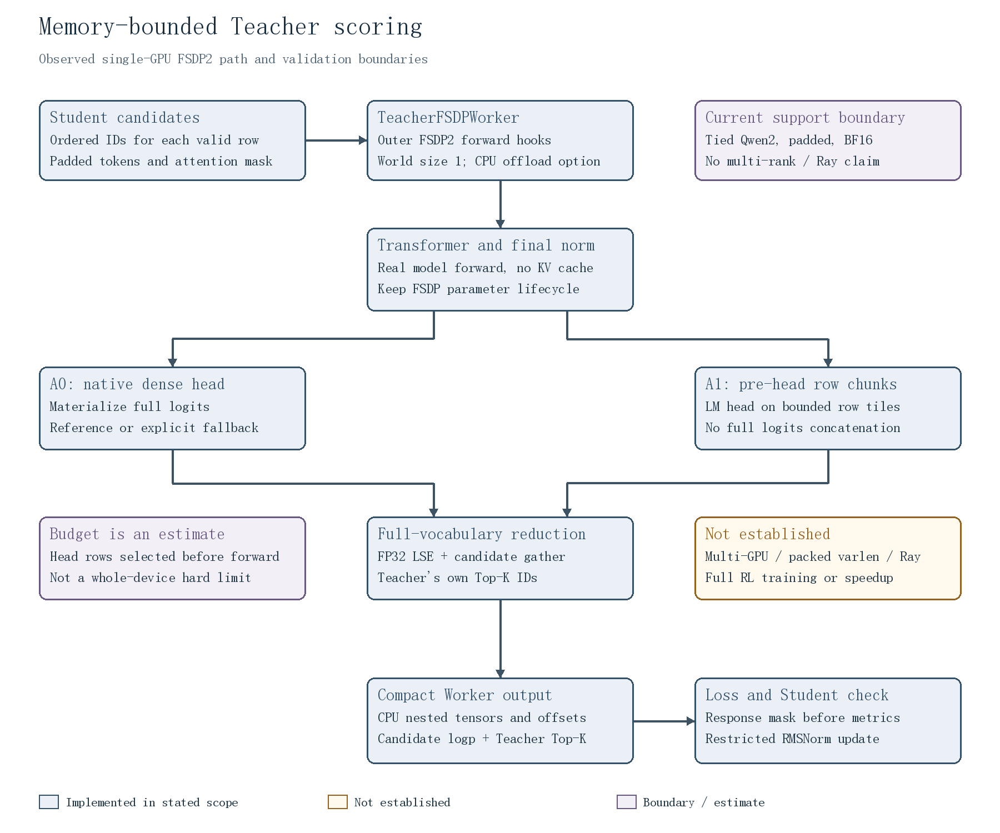
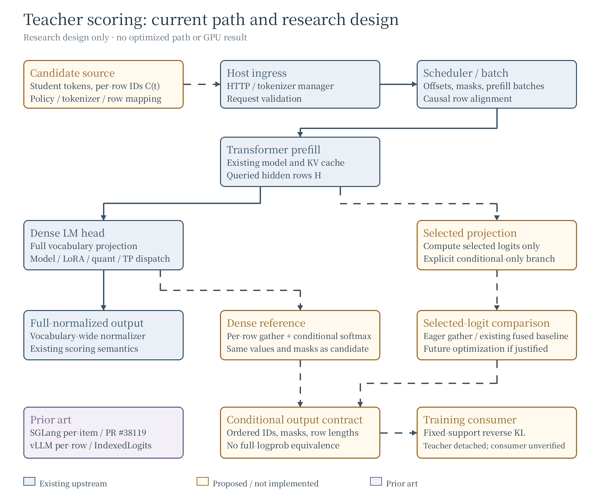
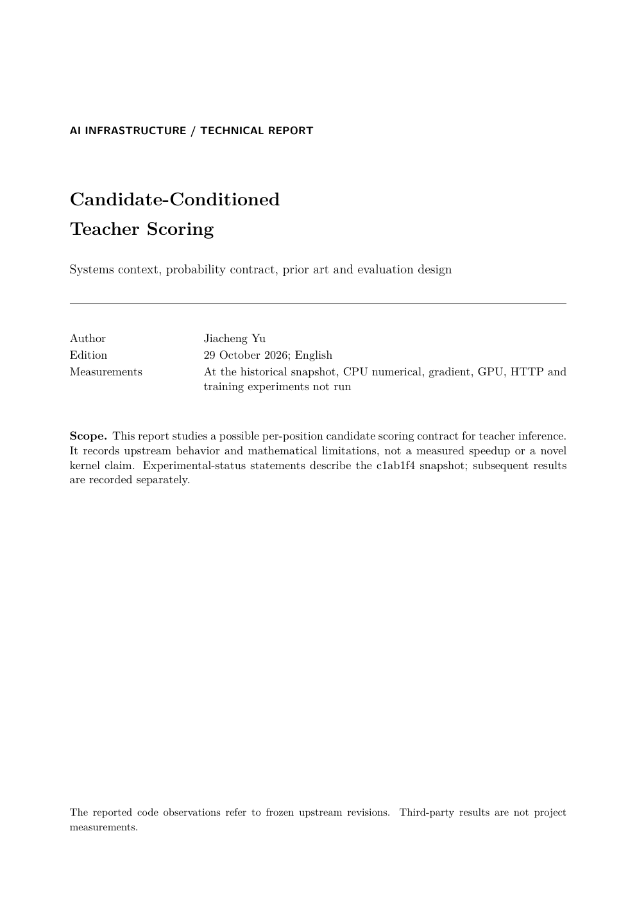

[English](./README.md) | [简体中文](./README.zh-CN.md)

# Memory-Bounded Teacher Scoring

Teacher scoring for language-model post-training can return only a small set of token scores while still materializing a much larger token-by-vocabulary logits tensor. This experimental, opt-in integration chunks hidden-state rows **before the LM head** in a real, pinned verl Teacher Worker. It preserves full-vocabulary-normalized log probabilities at the Student candidate IDs and the Teacher's own ordered Top-K, rather than substituting candidate-only normalization.

The implementation enters the normal outer FSDP2 forward, preserves tied weights and module hooks, and falls back to the native dense path when an unbudgeted chunk covers all rows. It targets single-GPU Qwen2 with CPU offload; the head budget is an estimate, not a device-wide hard limit. The earlier selected-logit fusion proposal remains **NO-GO** for the complete Teacher contract.

## Measured results

Real `TeacherFSDPWorker`, Qwen2.5-0.5B-Instruct, BF16, K=32, SDPA, 256-row chunks and the same PyTorch allocator fraction 0.50; inputs are synthetic. Each mode and length has two fresh processes in ABBA order, each with one first-call warmup and five measured calls. Values below are per-call PyTorch peaks and synchronized Worker `perf_counter` spans, including diagnostic hooks and journal activity.

| N | Peak allocated MiB, Dense / Chunked | Peak reserved MiB, Dense / Chunked | Warm p50 / p95 ms, Dense | Warm p50 / p95 ms, Chunked |
| ---: | ---: | ---: | ---: | ---: |
| 1,024 | 1,517.1 / 665.3 | 2,644 / 1,124 | 210.4 / 288.0 | 159.4 / 187.0 |
| 4,096 | 2,409.4 / 672.3 | 2,944 / 1,130 | 322.3 / 414.4 | 318.8 / 327.5 |
| 8,192 | 3,596.6 / 681.6 | 3,846 / 1,126 | 570.8 / 599.6 | 626.3 / 944.6 |

At N=8192, peak allocated decreases **81.05%** in this complete Worker-call scope; all 262,144 candidate logprobs and 8,192 ordered Teacher Top-K rows match the Dense reference exactly. All 96 saved first-call and measured outputs across the new matrix were reopened and compared. At fraction 0.50, Dense ran at N=8704 and OOMed at 9216; Chunked ran at 32768, the largest tested point. There is no same-length Dense numerical reference at 32768. These are PyTorch allocator results, not whole-card VRAM savings or a hard device partition.

Timing is descriptive: the 1024 Dense A/A process medians were 229.2 and 158.0 ms, and host clocks differed by up to 8.33% in the chunk-size sweep. In an earlier single cold N=8192 pair, Dense took 3,382 ms and Chunked 8,756 ms; the synchronized span extended through nested CPU return and included hooks and sampler activity. The earlier CUDA `unknown error` and clock discrepancies remain unexplained; no general acceleration or RL training benefit is claimed. A separate bounded Worker-to-loss-to-Student test matched the pinned loss and a restricted RMSNorm update; full Ray dispatch and RL training remain unverified.


[Results and scope](./docs/memory-bounded-teacher.en.md) · [Evidence manifest](./results/worker-evidence-manifest.json) · [Reproduce](./docs/experimental-reproduction.md) · [Experimental report](./docs/reports/memory-bounded-experimental.en.pdf) · [Historical G2 results](./docs/g2-results.en.md)

New experimental results and report text are AI-assisted and **pending Human review**.

## Industrial problem

An on-policy distillation (OPD) consumer may need teacher scores for a different set of token IDs at each causal position. Position selection, candidate selection, and probability normalization are separate problems. A compact response does not by itself avoid dense LM-head computation, and candidate-conditioned probabilities are not full-vocabulary probabilities. An open verl training implementation now provides a concrete conditional-loss consumer; its complete diagnostics still require full-vocabulary information.

## Prior art

- At [the audited SGLang revision](https://github.com/sgl-project/sglang/blob/4517a5ff1bbd1f944d6bde1819300ed14af7b698/python/sglang/srt/managers/tokenizer_manager_score_mixin.py), `/score` already supports per-item labels and optional candidate normalization; [position selection](https://github.com/sgl-project/sglang/blob/4517a5ff1bbd1f944d6bde1819300ed14af7b698/python/sglang/srt/layers/logits_processor.py) exists with dense readout.
- [SGLang PR #38119](https://github.com/sgl-project/sglang/pull/38119) implements per-position IDs on `sglang-miles` with full normalization; it was open when checked on 29 October 2026. [vLLM PR #56984](https://github.com/vllm-project/vllm/pull/56984) merged a per-row interface on 3 October 2026.
- [OmniLens](https://arxiv.org/abs/2608.10260v1) and [IndexedLogits](https://github.com/pettyjohnjn/indexed_logits/tree/6020cb446cde8cb2b74a8fdf90db905a320936c3) provide prior selected-logit work. This project does not claim that primitive as novel.
- Open [verl PR #7809](https://github.com/verl-project/verl/pull/7809) already implements a vocabulary-tiled, full-normalized selected-logprob path for Megatron student distillation. Its GPU results are third-party claims, not project results.

## Earlier research approach

For hidden row `h_t` and candidate set `C_t`, the proposed research contract obtains teacher logits for the ordered IDs and normalizes only over that set. A same-semantics dense reference must preserve causal shifts, masks, model-specific head transforms and candidate order. A potential selected projection must be compared with dense, chunked-dense, eager indexed and existing fused baselines.

Conditional reverse KL differs from full-vocabulary KL because it omits support mass and tail contributions. With one candidate, its loss and local gradient are zero. The inspected [Rethinking OPD author code](https://github.com/Thinking-Space/Rethinking-OPD/tree/ac26e38d6f1572eb027597b48a9f4e01f6915ef8) uses full-normalized log-ratio rewards and a PPO surrogate; conditional-only teacher scores are not a drop-in equivalent. Open [verl PR #6920](https://github.com/verl-project/verl/pull/6920) implements student-top-K conditional reverse KL, while also calculating teacher mass and teacher top-K diagnostics that selected logits alone cannot reproduce. Its reported training run has not been independently reproduced here.

## Architecture



The current diagram shows the single-GPU FSDP2 execution boundary, the pre-head row-chunked and dense fallback paths, and the response-mask boundary. The [editable bilingual topology](./docs/architecture/memory-bounded-topology.json) and [English SVG](./docs/architecture/memory-bounded.en.svg) generate the same diagram; unsupported and unverified paths remain explicit.

### Earlier research snapshot



This historical diagram distinguishes **existing upstream**, **proposed and unimplemented**, and **prior art** for the earlier research snapshot. [Editable topology](./docs/architecture/topology.json) generates both language editions; [English SVG](./docs/architecture/architecture.en.svg) is also available.

## Reproduction

The [experimental Worker reproduction](./docs/experimental-reproduction.md) covers the fixed environment, long-sequence Dense/Chunked comparison, no-fraction ABBA controls and response-mask tests.

These commands rebuild the documentation, not a scoring service or benchmark. Requirements: XeLaTeX, BibTeX, Poppler (`pdftoppm`, `pdfinfo`, `pdftotext`), Python 3 with Pillow, and the bundled limited-glyph font. For example:

```bash
bash scripts/build_assets.sh
python3 scripts/verify_assets.py
```

The [build environment lock](./docs/build-environment.md) records the documentation build versions and hashes. The [bundled font subset](./assets/fonts/README.md) is pinned and licensed under OFL 1.1. For new text requiring additional glyphs, install a full font from the [Noto CJK project](https://github.com/notofonts/noto-cjk) and set `CJK_FONT` to its absolute path. The public [benchmark methodology](./docs/benchmark-methodology.en.md) defines proposed experiments, baselines and reporting boundaries.

The independent [G2 reference, real teacher-scoring commands and observations](./docs/g2-results.en.md) document the separate Python environment and fixed model. These checks are not an optimized serving implementation.

## Historical G2 results and limitations

| Item | Status |
| --- | --- |
| Synthetic numerical and gradient reference | CPU and GPU checks passed on the recorded fixtures |
| SGLang teacher scoring | One real BF16 HTTP smoke request passed using synthetic candidate IDs |
| Real-model numerical comparison | **FAILED:** 2 of 32 values exceeded the frozen BF16 budget |
| FP32 precision diagnosis | IEEE Triton and torch-native attention passed; TF32 Triton exceeded the fixed budget |
| Representative performance and real training | **NOT ESTABLISHED**; one separate trace is exploratory |
| Project speedup, memory or quality gain | **NOT ESTABLISHED** |

The former G3 fusion proposal remains **NO-GO** for the full teacher contract; the current memory-bounded path is evaluated separately. Arithmetic or tensor-size examples in the report are analytical only; third-party measurements are not project results. The author reviewed both AI-assisted report editions at commit `c1ab1f4308c2ac1aecf47e222f210a16d0a5a898`; later substantive technical revisions require a new review. The reports describe that reviewed snapshot, while the new G2 observations are recorded separately and have not been author-reviewed.

## Report

[Experimental memory-bounded report (PDF)](./docs/reports/memory-bounded-experimental.en.pdf) · [Editable LaTeX](./docs/reports/memory-bounded-experimental.en.tex). This AI-assisted edition contains new results awaiting Human review.

The earlier report is retained as its originally reviewed research snapshot:

[](./docs/reports/technical-report.en.pdf)

[Read the English PDF](./docs/reports/technical-report.en.pdf) · [English TeX](./docs/reports/technical-report.en.tex) · [Shared equations](./docs/reports/common-equations.tex) · [Bibliography](./docs/reports/references.bib)
