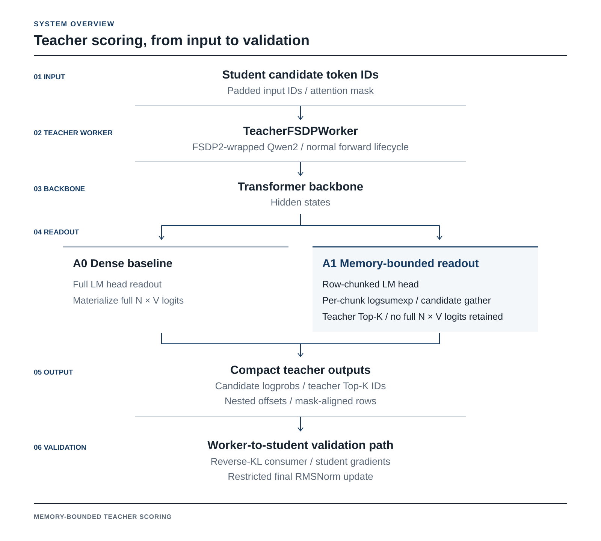
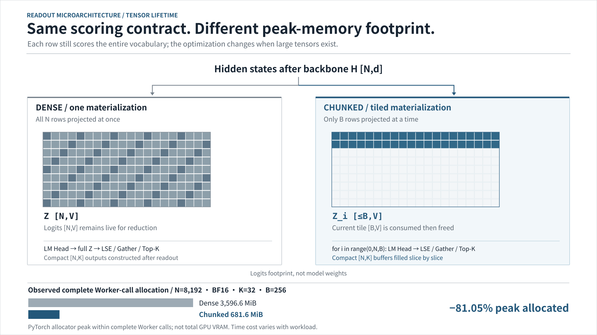

[English](./README.md) | [简体中文](./README.zh-CN.md)

# Memory-Bounded Teacher Scoring

**Full-vocabulary teacher scores with a smaller readout memory footprint.**

Teacher scoring in LLM post-training can allocate a large token-by-vocabulary logits tensor even when the consumer needs only compact outputs. This project integrates a row-chunked LM-head readout into a pinned verl `TeacherFSDPWorker`, preserving full-vocabulary-normalized candidate logprobs and the teacher's ordered Top-K. The implementation and its consumer path were evaluated in a single-GPU Qwen2/FSDP2 experimental setup.

[Technical report](./docs/reports/memory-bounded-experimental.en.pdf) · [Report source](./docs/reports/memory-bounded-experimental.en.tex) · [Reproduce](./docs/experimental-reproduction.md) · [Experiment data](./results/worker-benchmark-summary.json) · [Historical G2 results](./docs/g2-results.en.md)

## Key results

| Worker comparison at **N = 8,192** | Result |
| --- | --- |
| PyTorch peak allocated | **81.05% lower** · 3,596.6 → 681.6 MiB |
| Candidate logprobs | **262,144 / 262,144** exactly matched |
| Ordered teacher Top-K | **8,192 / 8,192** rows exactly matched |
| CPU regression CI | **171 passed**, 2 deselected · [main run](https://github.com/yu830/rl-posttrain-sparse-scoring/actions/runs/41056928510) |

The GPU comparison uses Qwen2.5-0.5B-Instruct, BF16, one RTX 5070 Laptop GPU, FSDP2 with CPU offload, SDPA, `K=32`, `chunk_rows=256`, and a PyTorch allocator fraction of `0.50`. Inputs are synthetic. The percentage describes **peak allocated by the PyTorch allocator during a complete Worker call**, not total device VRAM. CPU CI ran separately at the evaluated baseline revision [`ad395e9`](https://github.com/yu830/rl-posttrain-sparse-scoring/commit/ad395e94923bcf65fff4bc1eeb2e0e1505fd4f91).

## Why this matters

A compact API response does not guarantee a compact execution path: a dense LM head may still materialize `N × V` logits before selecting the requested values. Moving row chunking **before** the head limits the live logits tile while retaining the full-vocabulary normalizer and teacher Top-K required by the scoring contract. The project illustrates how to change a model execution path while respecting distributed-module lifecycle, output layout and a downstream training consumer—concerns shared by LLM runtime and RL infrastructure work.

## System overview

This figure separates **input alignment and readout policy** from **FSDP2 model execution**. Both strategies preserve the same Teacher Scoring contract; the important difference is **when vocabulary-sized tensors are materialized and released**.

<p align="center"></p>

- **Input contract:** Nested candidate IDs are aligned with padded rows through the real attention mask; invalid IDs and offsets are rejected before the outer FSDP call.
- **Readout policy:** A requested chunk size and optional estimated LM-head budget select the row tile. The budget is not a device-wide memory cap.
- **Execution:** Dense returns full logits before reduction. Chunked performs full-vocabulary LogSumExp, candidate Gather, and Teacher Top-K **within each tile**, then releases its temporary logits.
- **Output / validation:** Both paths return the original two-field CPU nested output. The dashed Worker-to-Student edge denotes a separate restricted consumer test, not an end-to-end Ray Trainer.

[Editable system SVG](./docs/architecture/system-overview.en.svg) · [PNG](./docs/architecture/system-overview.en.png)

<details>
<summary><strong>Expand: LM-head tensor lifetime and measured allocation</strong></summary>

<p align="center"></p>

[Vector SVG](./docs/architecture/readout-lifecycle.en.svg) · [PNG](./docs/architecture/readout-lifecycle.en.png)

</details>

## Verified results

The table reports per-call allocator peaks and synchronized warm Worker spans. Each mode and length used two fresh processes in ABBA order, with one warmup and five measured calls per process; p50 and p95 summarize ten measured calls.

| Projected rows `N` | Mode | Peak allocated (MiB) | Peak reserved (MiB) | p50 (ms) | p95 (ms) |
| ---: | :--- | ---: | ---: | ---: | ---: |
| 1,024 | Dense | 1,517.1 | 2,644 | 210.4 | 288.0 |
| 1,024 | Chunked | 665.3 | 1,124 | 159.4 | 187.0 |
| 4,096 | Dense | 2,409.4 | 2,944 | 322.3 | 414.4 |
| 4,096 | Chunked | 672.3 | 1,130 | 318.8 | 327.5 |
| 8,192 | Dense | 3,596.6 | 3,846 | 570.8 | 599.6 |
| 8,192 | Chunked | 681.6 | 1,126 | 626.3 | 944.6 |

<p align="center"></p>

The 81.05% figure applies only to **peak allocated** at `N=8192`; reserved memory is reported separately. Timing includes diagnostic hooks and CPU return, and the small sample showed process and clock variation, so it is descriptive rather than a general speedup claim. Under the same allocator fraction, Dense succeeded at 8,704 rows and OOMed at 9,216; Chunked ran at the largest tested point, 32,768. The latter has no same-length Dense reference. See the [detailed results](./docs/memory-bounded-teacher.en.md) and [evidence manifest](./results/worker-evidence-manifest.json) for the full measurement context.

## Reproducibility

The GPU Worker setup uses Linux x86-64, Python 3.12, a CUDA-capable NVIDIA GPU, the [hash-locked dependencies](./requirements-worker-linux-py312.lock), [verl revision `87cd055`](https://github.com/verl-project/verl/tree/87cd055e872f9fdd7b976fcd797a0934b6dba265), and the pinned Qwen2.5-0.5B-Instruct model. Follow the [setup and model instructions](./docs/experimental-reproduction.md) to prepare `VERL_DIR`, `MODEL_DIR`, and `OUT_DIR`, and apply the integration patch. Then run this short Dense/Chunked comparison from the repository root:

```bash
python scripts/long_worker_probe.py --verl-dir "$VERL_DIR" --model-dir "$MODEL_DIR" \
  --out "$OUT_DIR/dense-1024.json" --mode dense --lengths 1024 --k 32 \
  --chunk-rows 256 --allocator-fraction 0.50 --warmup 1 --repeats 2 --sample-device-ms 0
python scripts/long_worker_probe.py --verl-dir "$VERL_DIR" --model-dir "$MODEL_DIR" \
  --out "$OUT_DIR/chunked-1024.json" --mode chunked --lengths 1024 --k 32 \
  --chunk-rows 256 --allocator-fraction 0.50 --warmup 1 --repeats 2 --sample-device-ms 0
python scripts/compare_capacity_outputs.py --dense "$OUT_DIR/dense-1024.call01.pt" \
  --candidate "$OUT_DIR/chunked-1024.call01.pt" --out "$OUT_DIR/compare-1024.json"
```

The [CPU CI workflow](./.github/workflows/cpu-tests.yml) uses its own hash-locked CPU environment, fetches pinned verl source for patch checks, and runs deterministic regressions without model weights. It is separate from the real GPU Worker measurements; two full Trainer-runtime parity cases are deselected in that job. The reproduction guide also contains the full benchmark matrix, capacity tests and environment details.

## Current scope

The measured implementation targets a tied-head Qwen2 model on one GPU with FSDP2; the Worker-to-student experiment checks one restricted final-RMSNorm update. Full RL training throughput, Ray-dispatched execution, multi-GPU behavior and production stability are outside the present validation. Allocator fractions and the readout budget estimate are not whole-device memory limits.

## Future work

- Extend validation to multi-GPU, tensor parallelism and FSDP1.
- Add and validate packed variable-length inputs and broader model/head coverage.
- Study the longer-sequence capacity frontier with same-length numerical references where feasible.
- Integrate the path into an end-to-end RL trainer and measure throughput and stability.

## Project map

| Path | Contents |
| --- | --- |
| [`integrations/verl_6920/`](./integrations/verl_6920/) | Opt-in verl patch and integration instructions |
| [`scripts/`](./scripts/) | Worker probes, comparisons and report build scripts |
| [`tests/`](./tests/) | Scoring, integration and regression tests |
| [`results/`](./results/) | Aggregated results and evidence manifest |
| [`docs/reports/`](./docs/reports/) | Bilingual reports and editable sources |

The earlier selected-logit fusion proposal remains **NO-GO** for the full Teacher contract; the [historical results](./docs/g2-results.en.md) retain its negative findings.
