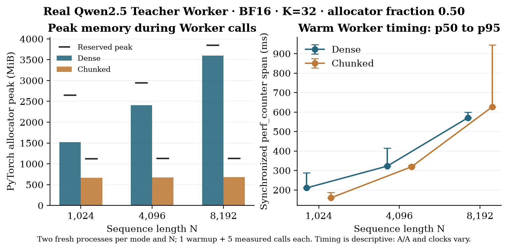
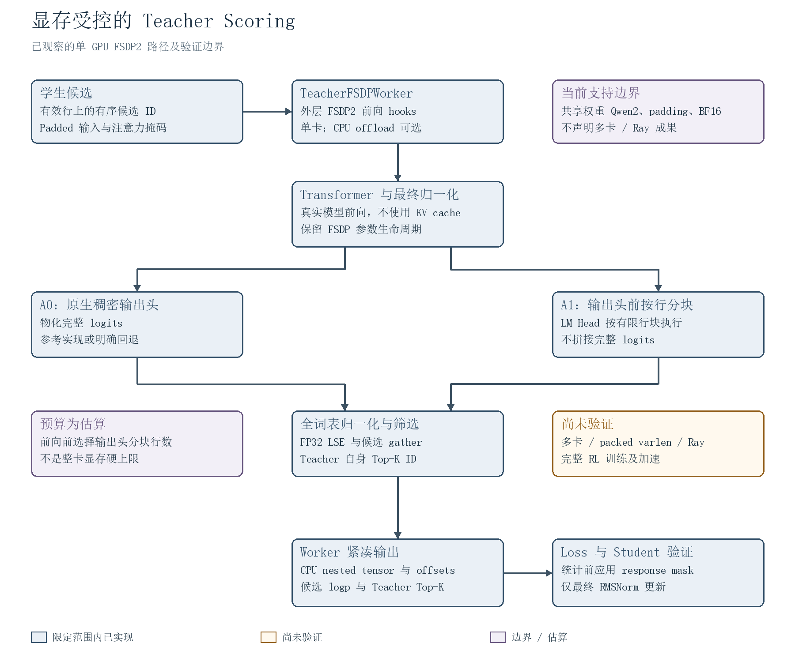
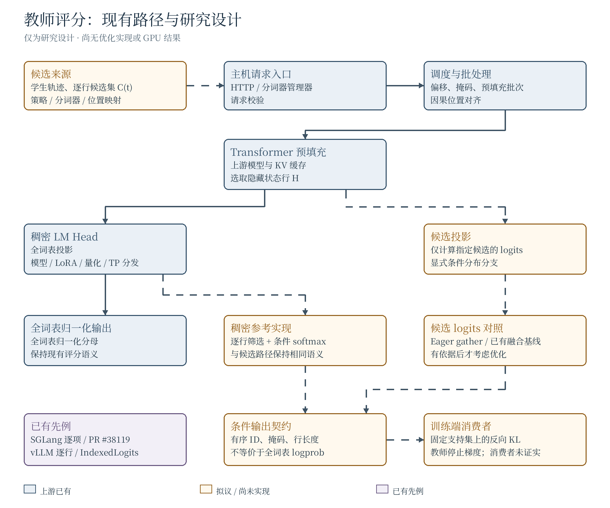
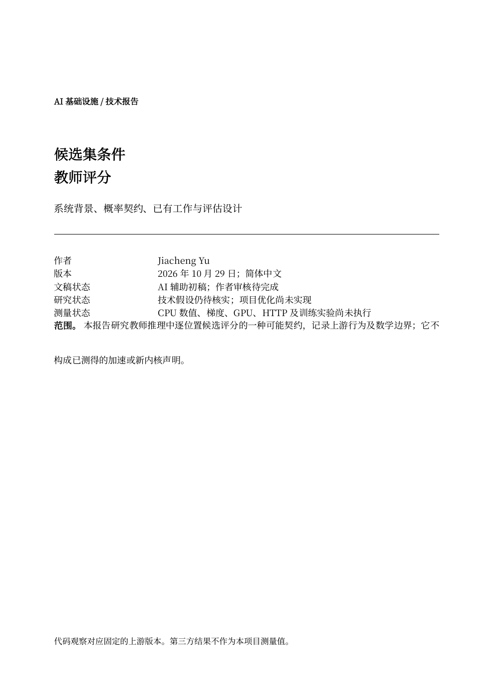

[English](./README.md) | [简体中文](./README.zh-CN.md)

# 显存预算约束的教师评分

语言模型后训练中的教师评分即使只返回少量 token 分数，也可能先生成庞大的“token × 词表”logits 张量。本项目在固定版本的真实 verl Teacher Worker 中，将隐藏状态按行分块前移到 **LM Head 之前**。该实验性、可选启用的集成保留学生候选 ID 上的全词表归一化 logprob 和教师自身的有序 Top-K，而非将其替换为仅在候选集内归一化的分数。

实现通过正常的外层 FSDP2 forward 执行，保留共享权重和模块 hooks；无预算且单块覆盖全部行时回退到原生 Dense 路径。当前目标为单 GPU Qwen2 与 CPU offload；输出头预算是估算值，并非整卡显存硬上限。早期 selected-logit 融合方案对完整 Teacher 契约仍为 **NO-GO**。

## 实测结果

真实 `TeacherFSDPWorker`、Qwen2.5-0.5B-Instruct、BF16、K=32、SDPA、256 行分块，双方均使用 PyTorch allocator fraction 0.50；输入为合成数据。每个长度和路径采用 ABBA 顺序的两个独立进程，每进程一次首次调用预热、五次计数。下表是逐次 Worker 调用的 PyTorch 峰值与同步 `perf_counter` 耗时，包含诊断 hooks 和日志开销。

| N | Peak allocated MiB，Dense / Chunked | Peak reserved MiB，Dense / Chunked | 预热后 p50 / p95 ms，Dense | 预热后 p50 / p95 ms，Chunked |
| ---: | ---: | ---: | ---: | ---: |
| 1,024 | 1,517.1 / 665.3 | 2,644 / 1,124 | 210.4 / 288.0 | 159.4 / 187.0 |
| 4,096 | 2,409.4 / 672.3 | 2,944 / 1,130 | 322.3 / 414.4 | 318.8 / 327.5 |
| 8,192 | 3,596.6 / 681.6 | 3,846 / 1,126 | 570.8 / 599.6 | 626.3 / 944.6 |

N=8192 时，完整 Worker 调用的 peak allocated 在该分配器口径下降低 **81.05%**；262,144 个候选 logprob 与 8,192 行有序 Teacher Top-K 均与 Dense 逐值一致。新矩阵保存的 96 份首次调用和计数输出均已重新读取并比较。fraction 0.50 下，Dense 在 N=8704 成功、9216 OOM；Chunked 在已测最大点 32768 成功。32768 尚无同长度 Dense 数值参考。这些结果属于 PyTorch allocator，而非整卡 VRAM 降幅或设备硬分区。

时延仅作描述：1024 Dense 的两进程 A/A 中位数为 229.2 和 158.0 ms，分块大小实验的主机时钟差异最高达 8.33%。此前单次 N=8192 冷调用中 Dense 为 3,382 ms、Chunked 为 8,756 ms；同步计时覆盖至 nested CPU 返回，并包含 hooks 与采样活动。早先 CUDA `unknown error` 与时钟差异仍未归因；这里不声明通用加速或 RL 训练收益。另一个有界 Worker-to-loss-to-Student 实验验证了固定 Loss 与受限 RMSNorm 更新一致；完整 Ray 调度和 RL 训练尚未验证。



[结果与适用范围](./docs/memory-bounded-teacher.zh-CN.md) · [证据清单](./results/worker-evidence-manifest.json) · [复现说明](./docs/experimental-reproduction.md) · [实验报告](./docs/reports/memory-bounded-experimental.zh-CN.pdf) · [历史 G2 结果](./docs/g2-results.zh-CN.md)

新增实验结果和报告文字由 AI 辅助整理，**等待 Human 审核**。

## 行业问题

在线策略蒸馏（On-Policy Distillation，OPD）的消费者可能需要在每个因果位置请求不同 token ID 的教师分数。位置选择、候选选择和概率归一化是三个不同问题。紧凑响应本身不能避免稠密 LM Head 计算；候选集条件概率也不等于全词表概率。一个开放的 verl 训练实现已提供具体的条件损失消费者，但其完整诊断仍需全词表信息。

## 已有工作

- 在[所核查的 SGLang 版本](https://github.com/sgl-project/sglang/blob/4517a5ff1bbd1f944d6bde1819300ed14af7b698/python/sglang/srt/managers/tokenizer_manager_score_mixin.py)中，`/score` 已支持逐项标签和可选的候选集归一化；[位置选择](https://github.com/sgl-project/sglang/blob/4517a5ff1bbd1f944d6bde1819300ed14af7b698/python/sglang/srt/layers/logits_processor.py)已存在，但使用稠密输出头。
- [SGLang PR #38119](https://github.com/sgl-project/sglang/pull/38119) 在 `sglang-miles` 上实现了全词表归一化的逐位置 ID；2026 年 10 月 29 日核查时仍开放。[vLLM PR #56984](https://github.com/vllm-project/vllm/pull/56984) 于 2026 年 10 月 3 日合并逐行接口。
- [OmniLens](https://arxiv.org/abs/2608.10260v1) 与 [IndexedLogits](https://github.com/pettyjohnjn/indexed_logits/tree/6020cb446cde8cb2b74a8fdf90db905a320936c3) 已有候选 logits 工作；本项目不将该原语称为原创。
- 开放的 [verl PR #7809](https://github.com/verl-project/verl/pull/7809) 已为 Megatron 学生蒸馏实现词表分块、全归一化的候选 logprob 路径；其 GPU 结果属于第三方声明，不是本项目结果。

## 早期研究思路

对于隐藏状态行 `h_t` 和候选集 `C_t`，拟议研究契约获取有序 ID 对应的教师 logits，并只在候选集内归一化。语义一致的稠密参考必须保留因果位移、掩码、模型输出头变换与候选顺序。潜在候选投影需与稠密、分块稠密、eager 索引以及已有融合实现比较。

条件反向 KL 忽略支持集总概率和尾部项，因而不同于全词表 KL。候选数为一时，其损失与局部梯度为零。所核查的 [Rethinking OPD 作者代码](https://github.com/Thinking-Space/Rethinking-OPD/tree/ac26e38d6f1572eb027597b48a9f4e01f6915ef8)使用全归一化 log-ratio 奖励和 PPO surrogate；仅条件化的教师分数不能等价替换。开放的 [verl PR #6920](https://github.com/verl-project/verl/pull/6920)实现了学生 Top-K 条件反向 KL，但也计算仅凭候选 logits 无法恢复的教师概率质量及教师 Top-K 诊断。该 PR 报告的训练运行尚未在本项目独立复现。

## 架构



当前架构图展示单 GPU FSDP2 执行边界、输出头前的行分块与稠密回退，以及 response mask 的消费边界。[可编辑的双语拓扑](./docs/architecture/memory-bounded-topology.json)与[中文 SVG](./docs/architecture/memory-bounded.zh-CN.svg)对应同一张图；不支持或未验证的路径均明确标注。

### 早期研究快照



这张历史图区分早期研究快照中的**上游已有**、**拟议且尚未实现**和**已有先例**。[可编辑拓扑](./docs/architecture/topology.json)生成中英文两个版本；也可查看[中文 SVG](./docs/architecture/architecture.zh-CN.svg)。

## 复现

[实验版 Worker 复现说明](./docs/experimental-reproduction.md)列出固定环境、长序列 Dense/Chunked 对照、无人工 fraction 的 ABBA 对照和 response mask 测试。

以下命令重建文档，不会运行评分服务或基准测试。依赖：XeLaTeX、BibTeX、Poppler（`pdftoppm`、`pdfinfo`、`pdftotext`）、带 Pillow 的 Python 3，以及随仓库提供的有限字符集字体。例如：

```bash
bash scripts/build_assets.sh
python3 scripts/verify_assets.py
```

[构建环境锁定记录](./docs/build-environment.md)列出文档构建所用的版本与哈希。[随附字体子集](./assets/fonts/README.md)已固定版本，采用 OFL 1.1 许可。添加新文字需要额外字形时，可从 [Noto CJK 项目](https://github.com/notofonts/noto-cjk)安装完整字体，再将 `CJK_FONT` 指向其绝对路径。公开的[基准测试方法](./docs/benchmark-methodology.zh-CN.md)说明拟议实验、基线与报告边界。

独立的 [G2 参考、真实教师评分命令与观察](./docs/g2-results.zh-CN.md)记录了单独的 Python 环境和固定模型。这些检查不是优化后的服务实现。

## 历史 G2 结果与局限

| 项目 | 状态 |
| --- | --- |
| 合成数值与梯度参考 | 记录的测试输入在 CPU 和 GPU 上通过 |
| SGLang 教师评分 | 使用合成候选 ID 的一次真实 BF16 HTTP 冒烟请求通过 |
| 真实模型数值对照 | **未通过：**32 个数值中有 2 个超过冻结的 BF16 容差 |
| FP32 精度诊断 | IEEE Triton 与原生注意力通过；TF32 Triton 超出固定容差 |
| 代表性性能与真实训练 | **尚未证实**；一次单独轨迹仅用于探索 |
| 本项目加速、显存或质量收益 | **尚未证实** |

此前 G3 融合方案对完整教师契约仍为 **NO-GO**；当前显存受控路径单独评估。报告中的运算量和张量大小示例仅为解析值；第三方测量不属于本项目结果。作者已审核提交 `c1ab1f4308c2ac1aecf47e222f210a16d0a5a898` 的两份 AI 辅助报告；后续实质性技术修订须重新审核。报告描述已审核快照，新增 G2 观察另行记录，尚未经过作者审核。

## 报告

[显存受控实验技术报告（PDF）](./docs/reports/memory-bounded-experimental.zh-CN.pdf) · [可编辑 LaTeX](./docs/reports/memory-bounded-experimental.zh-CN.tex)。本版由 AI 辅助整理，新增结果等待 Human 审核。

下方旧报告保留原已审核研究快照：

[](./docs/reports/technical-report.zh-CN.pdf)

[阅读中文 PDF](./docs/reports/technical-report.zh-CN.pdf) · [中文 TeX](./docs/reports/technical-report.zh-CN.tex) · [共享公式](./docs/reports/common-equations.tex) · [参考文献](./docs/reports/references.bib)
