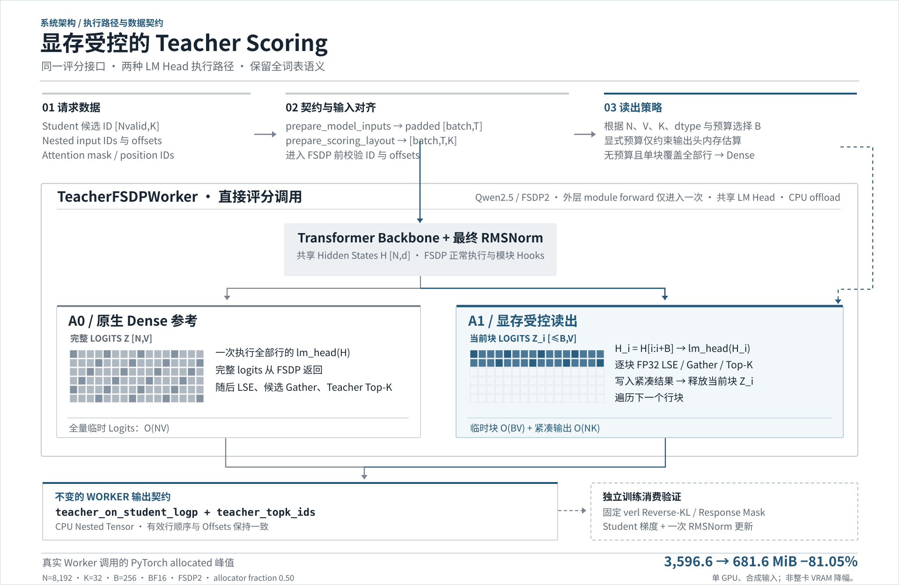
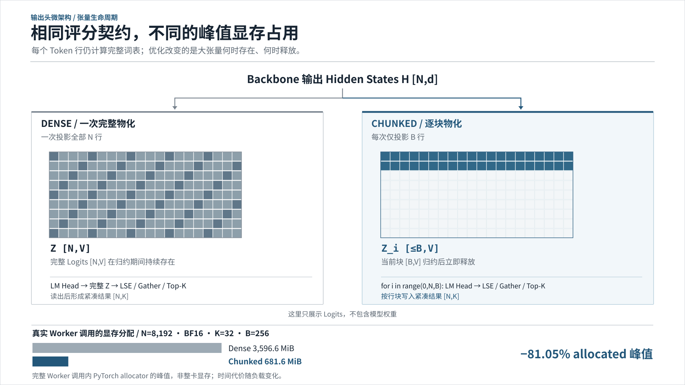
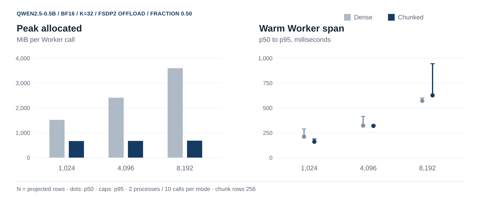

[English](./README.md) | [简体中文](./README.zh-CN.md)

# 显存受控的教师评分

**保留全词表评分语义，降低输出头读出的显存开销。**

LLM 后训练中的教师评分即使只返回紧凑结果，也可能先分配巨大的 token × 词表 logits 张量。本项目在固定版本的 verl `TeacherFSDPWorker` 中，将 LM Head 读出按行分块，保留学生候选 token 的全词表归一化 logprob 和教师自身的有序 Top-K。实现及其消费者路径已在单 GPU Qwen2/FSDP2 实验环境中验证。

[技术报告](./docs/reports/memory-bounded-experimental.zh-CN.pdf) · [报告源文件](./docs/reports/memory-bounded-experimental.zh-CN.tex) · [复现实验](./docs/experimental-reproduction.md) · [实验数据](./results/worker-benchmark-summary.json) · [历史 G2 结果](./docs/g2-results.zh-CN.md)

## 关键结果

| **N = 8,192** 的 Worker 对照 | 结果 |
| --- | --- |
| PyTorch peak allocated | **降低 81.05%** · 3,596.6 → 681.6 MiB |
| 候选 logprob | **262,144 / 262,144** 逐值一致 |
| 有序教师 Top-K | **8,192 / 8,192** 行一致 |
| CPU 回归 CI | **171 项通过**，2 项取消选择 · [main 运行记录](https://github.com/yu830/rl-posttrain-sparse-scoring/actions/runs/41056928510) |

GPU 对照条件：Qwen2.5-0.5B-Instruct、BF16、单张 RTX 5070 Laptop GPU、FSDP2 + CPU offload、SDPA、`K=32`、`chunk_rows=256`、PyTorch allocator fraction `0.50`；输入为合成数据。百分比表示**完整 Worker 调用中 PyTorch 分配器的 peak allocated**，不代表整卡 VRAM 降幅。CPU CI 独立运行，所对应的实验基线为提交 [`ad395e9`](https://github.com/yu830/rl-posttrain-sparse-scoring/commit/ad395e94923bcf65fff4bc1eeb2e0e1505fd4f91)。

## 工程价值

返回紧凑结果并不意味着执行过程也紧凑：稠密 LM Head 仍可能先生成完整的 `N × V` logits。将行分块前移到 **LM Head 之前**，可以限制同时存活的 logits 大小，同时保留评分契约所需的全词表归一化项和教师 Top-K。这一实现展示了如何在优化模型执行路径时兼顾分布式模块生命周期、输出布局和下游训练消费者，适用于 LLM Runtime 与 RL Infra 的工程问题。

## 系统概览

这张架构图将 **输入对齐与策略选择** 和 **实际 FSDP2 执行路径** 分开。Dense 与 Chunked 返回相同的 Teacher Scoring 契约，关键差别是完整词表 Logits 的**物化时机和内存生命周期**。

<p align="center"></p>

- **输入契约：** Nested 候选 ID 按 Attention Mask 对齐至 Padded 模型行，并在进入 FSDP 前检查 ID 范围和 Offsets。
- **预算决策：** 根据 Chunk Size 和可选的 LM Head 显存估算选择行块；预算不代表整卡显存硬上限。
- **执行差异：** Dense 返回完整 Logits 后再归约；Chunked 在**每个 Tile 内**执行全词表 LogSumExp、候选 Gather 与 Teacher Top-K，随后释放当前 Tile。
- **输出与验证：** 两种路径均返回原有的两个 CPU Nested Tensor；虚线边连接的是独立的 Reverse-KL / 受限 Student 更新实验，而非完整 Ray Trainer。

[可编辑系统图 SVG](./docs/architecture/system-overview.zh-CN.svg) · [PNG](./docs/architecture/system-overview.zh-CN.png)

<details>
<summary><strong>展开：LM Head 分块执行与张量生命周期</strong></summary>

<p align="center"></p>

[矢量 SVG](./docs/architecture/readout-lifecycle.zh-CN.svg) · [PNG](./docs/architecture/readout-lifecycle.zh-CN.png)

</details>

## 验证结果

下表列出逐次调用的分配器峰值和同步后的预热 Worker 耗时。每个模式、每个长度按 ABBA 顺序使用两个独立进程，每进程预热一次、测量五次；p50 与 p95 汇总十次测量。

| 投影行数 `N` | 模式 | Peak allocated (MiB) | Peak reserved (MiB) | p50 (ms) | p95 (ms) |
| ---: | :--- | ---: | ---: | ---: | ---: |
| 1,024 | Dense | 1,517.1 | 2,644 | 210.4 | 288.0 |
| 1,024 | Chunked | 665.3 | 1,124 | 159.4 | 187.0 |
| 4,096 | Dense | 2,409.4 | 2,944 | 322.3 | 414.4 |
| 4,096 | Chunked | 672.3 | 1,130 | 318.8 | 327.5 |
| 8,192 | Dense | 3,596.6 | 3,846 | 570.8 | 599.6 |
| 8,192 | Chunked | 681.6 | 1,126 | 626.3 | 944.6 |

<p align="center"></p>

81.05% 仅指 `N=8192` 时的 **peak allocated**；reserved 单独列出。时延包含诊断 hooks 和返回 CPU 的过程，小样本中存在进程及主机时钟波动，因此仅用于描述，不作为通用加速结论。同一 allocator fraction 下，Dense 在 8,704 行成功、9,216 行 OOM；Chunked 在已测最大点 32,768 行运行成功，但该点没有同长度 Dense 参考。完整测量条件见[详细结果](./docs/memory-bounded-teacher.zh-CN.md)和[证据清单](./results/worker-evidence-manifest.json)。

## 复现

GPU Worker 环境使用 Linux x86-64、Python 3.12、支持 CUDA 的 NVIDIA GPU、[哈希锁定依赖](./requirements-worker-linux-py312.lock)、[verl 固定版本 `87cd055`](https://github.com/verl-project/verl/tree/87cd055e872f9fdd7b976fcd797a0934b6dba265)及固定版本的 Qwen2.5-0.5B-Instruct。按[环境与模型准备说明](./docs/experimental-reproduction.md)设置 `VERL_DIR`、`MODEL_DIR`、`OUT_DIR` 并应用集成补丁，然后在仓库根目录执行：

```bash
python scripts/long_worker_probe.py --verl-dir "$VERL_DIR" --model-dir "$MODEL_DIR" \
  --out "$OUT_DIR/dense-1024.json" --mode dense --lengths 1024 --k 32 \
  --chunk-rows 256 --allocator-fraction 0.50 --warmup 1 --repeats 2 --sample-device-ms 0
python scripts/long_worker_probe.py --verl-dir "$VERL_DIR" --model-dir "$MODEL_DIR" \
  --out "$OUT_DIR/chunked-1024.json" --mode chunked --lengths 1024 --k 32 \
  --chunk-rows 256 --allocator-fraction 0.50 --warmup 1 --repeats 2 --sample-device-ms 0
python scripts/compare_capacity_outputs.py --dense "$OUT_DIR/dense-1024.call01.pt" \
  --candidate "$OUT_DIR/chunked-1024.call01.pt" --out "$OUT_DIR/compare-1024.json"
```

[CPU CI 工作流](./.github/workflows/cpu-tests.yml)使用独立的 CPU 哈希锁环境，获取固定 verl 源码执行补丁检查，并在不下载模型权重的情况下运行确定性回归。它与真实 GPU Worker 测量分开；该工作流取消选择了两项依赖完整 Trainer runtime 的对照测试。复现指南还包含完整基准矩阵、容量测试及环境细节。

## 当前范围

已测实现面向单 GPU FSDP2 下使用共享输出头的 Qwen2；Worker 到 Student 的实验检查了一次受限的最终 RMSNorm 更新。完整 RL 训练吞吐、Ray 调度、多 GPU 行为和生产稳定性不在当前验证范围内。allocator fraction 和输出头预算估算都不是整卡显存硬上限。

## 后续工作

- 扩展多 GPU、张量并行和 FSDP1 验证。
- 支持并验证 packed 变长输入，以及更多模型和输出头。
- 探索更长序列的容量边界，并在可行时提供同长度数值参考。
- 接入端到端 RL Trainer，测量吞吐与稳定性。

## 项目结构

| 路径 | 内容 |
| --- | --- |
| [`integrations/verl_6920/`](./integrations/verl_6920/) | 可选 verl 补丁与集成说明 |
| [`scripts/`](./scripts/) | Worker 探针、对照工具及报告构建脚本 |
| [`tests/`](./tests/) | 评分、集成与回归测试 |
| [`results/`](./results/) | 汇总结果与证据清单 |
| [`docs/reports/`](./docs/reports/) | 中英文报告及可编辑源文件 |

早期 selected-logit 融合方案对完整教师契约仍为 **NO-GO**；[历史结果](./docs/g2-results.zh-CN.md)保留了相应负结果。
